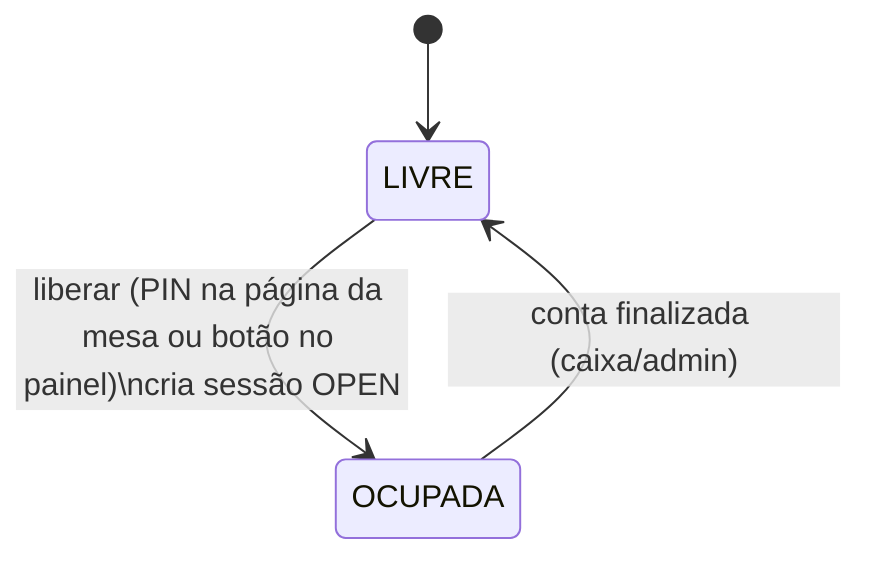
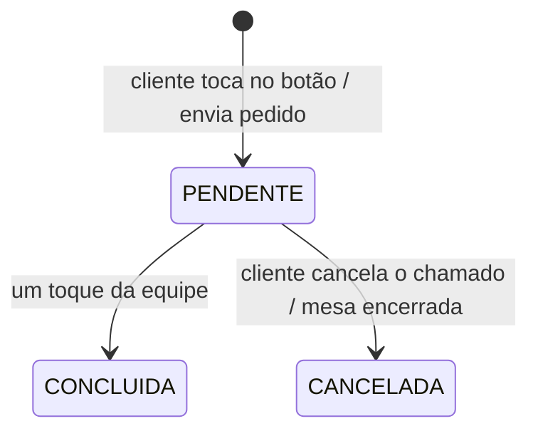

# Estados

Definidos em `backend/app/domain/states.py`. O fluxo é propositalmente curto: cada solicitação só é
**feita** e depois **resolvida**, com o horário de cada momento. Diagramas em Mermaid (renderizam no GitHub).

## Mesa

- “Pediu a conta” não é um estado da mesa: o painel mostra a mesa em destaque enquanto existir um
  `PEDIR_CONTA` aguardando (`bill_requested`).
- Conta finalizada, no mesmo COMMIT: sessão `CLOSED`, tokens do cliente revogados, `PEDIR_CONTA` concluído,
  demais solicitações ainda aguardando marcadas como `CANCELADA`, mesa `LIVRE`, eventos no outbox.

## Sessão da mesa (atendimento)
`OPEN → CLOSED`. No máximo uma `OPEN` por mesa (índice único parcial `uq_open_session_per_table`).
O histórico de cada mesa é a lista de sessões encerradas com suas solicitações.

## Solicitação (service request)

| Tipo | Botão da equipe (PENDENTE → CONCLUIDA) | O cliente vê |
|---|---|---|
| `CHAMAR_ATENDENTE` | **Atendido** | Aguardando → Atendido |
| `NOVO_PEDIDO` (um por pedido do cardápio) | **Repassado à cozinha** | Enviado → Repassado à cozinha |
| `PEDIR_CONTA` | **Conta finalizada** (encerra a mesa) | Solicitada → atendimento encerrado |

- Um chamado **aguardando** por tipo e sessão (exceto pedidos): repetir o toque devolve o mesmo chamado.
  Depois de resolvido, um novo chamado legítimo é aceito.
- Ao resolver, ficam gravados `completed_at` e `completed_by_id` (quem tocou).
- Resolver é uma atualização condicional (`WHERE status = 'PENDENTE'`): toques simultâneos não duplicam.
