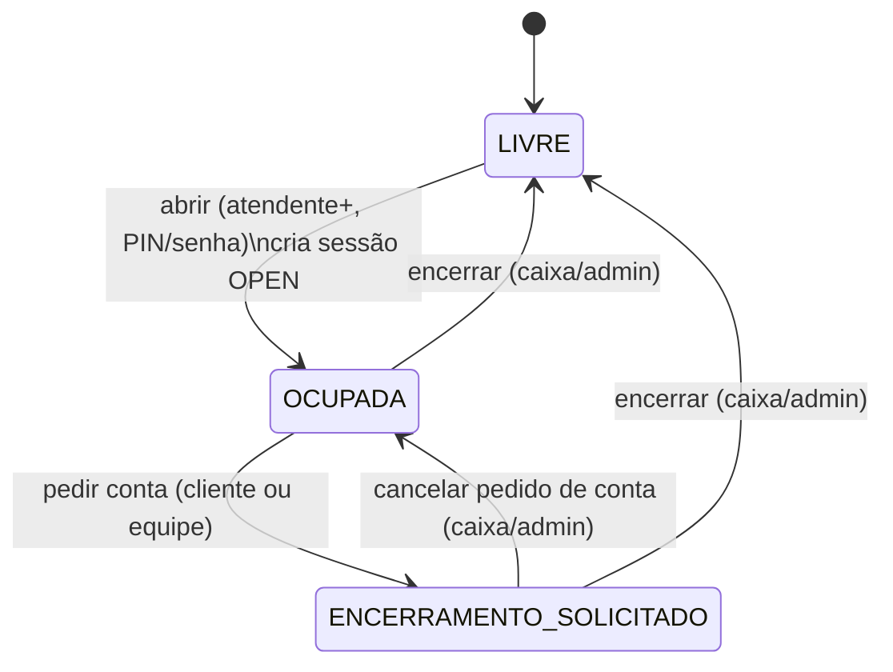
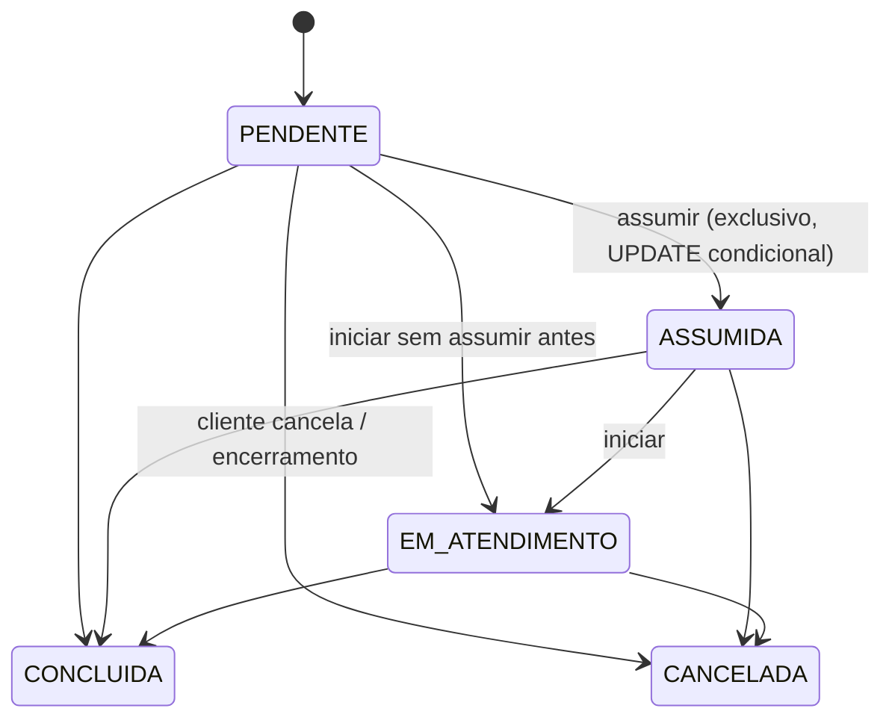

# Máquinas de estado

Implementadas em `backend/app/domain/states.py`. Transições fora destas tabelas retornam
`409 invalid_transition`. Diagramas em Mermaid (renderizam no GitHub).

## Mesa

Encerrar exige: sessão aberta e versão esperada (se enviada) igual à atual. No mesmo COMMIT: tokens do
cliente revogados, chamados ativos finalizados (o pedido de conta vira `CONCLUIDA`, os demais `CANCELADA`),
mesa `LIVRE` e eventos gravados no outbox.

## Sessão da mesa
`OPEN → CLOSED`. No máximo uma `OPEN` por mesa (índice único parcial `uq_open_session_per_table`).

## Chamado (service request)

- Tipos: `CHAMAR_ATENDENTE` e `PEDIR_CONTA`.
- Um chamado **ativo** por tipo e sessão: repetir o toque devolve o mesmo chamado.
  Depois de concluído, um novo chamado legítimo é aceito.
- `PEDIR_CONTA` é concluído pelo caixa ao encerrar a mesa.

## Etiqueta NFC (`table_tags`)
```
PENDENTE → GRAVANDO → GRAVADA → TRAVADA
   ↓          ↓          ↓
 FALHA ←──────┴──────────┘   FALHA → GRAVANDO (tentar de novo)
 qualquer estado não final → SUBSTITUIDA (nova gravação ou troca de etiqueta)
```
Tabela em `backend/app/domain/states.py` (`TAG_TRANSITIONS`). Uma etiqueta "viva" por mesa e um mesmo chip (UID)
em no máximo uma mesa: índices únicos parciais no banco.
