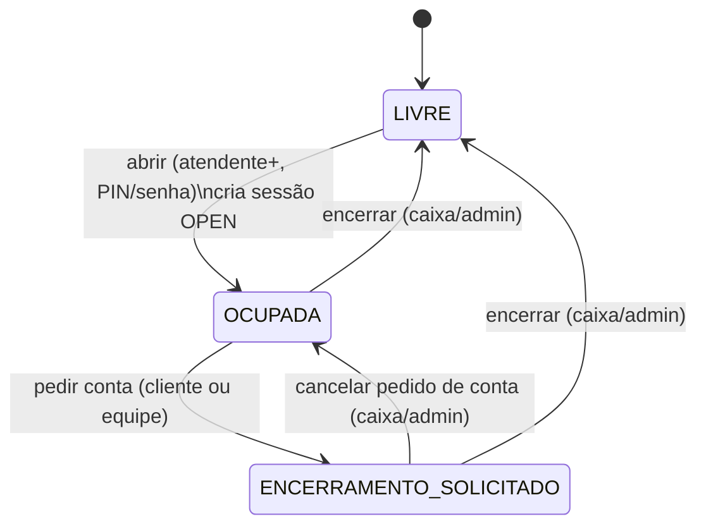
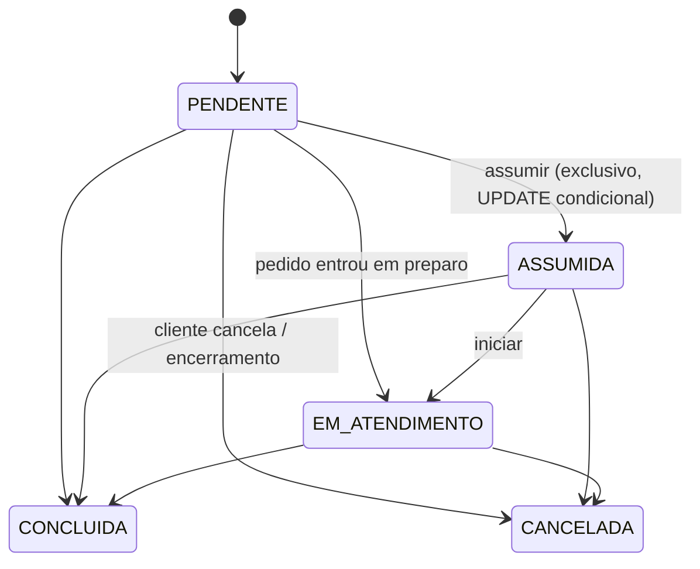
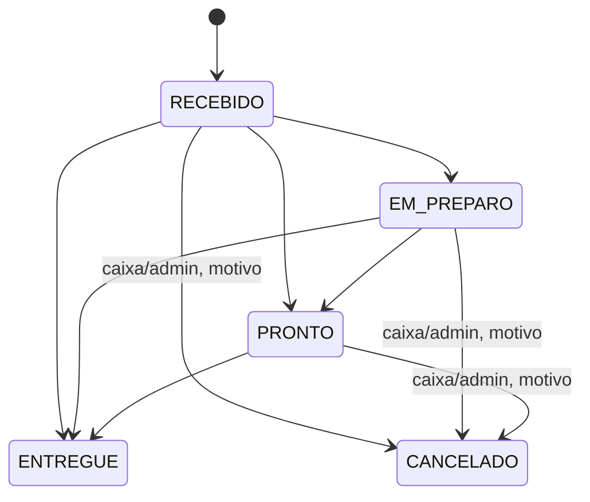

# Máquinas de estado

Implementadas em `backend/app/domain/states.py`. Transições fora destas tabelas retornam
`409 invalid_transition`. Diagramas em Mermaid (renderizam no GitHub).

## Mesa

Encerrar exige: sessão aberta, versão esperada (se enviada) igual à atual e **nenhum pedido pendente**
(`RECEBIDO`, `EM_PREPARO`, `PRONTO`) — ou a política explícita `cancel_pending` com motivo. No mesmo COMMIT:
pedidos pendentes cancelados (se for o caso), cupom resgatado, totais gravados, tokens do cliente revogados,
chamados ativos finalizados, mesa `LIVRE`, eventos no outbox.

## Sessão da mesa
`OPEN → CLOSED`. No máximo uma `OPEN` por mesa (índice único parcial `uq_open_session_per_table`).

## Chamado (service request)

- Tipos: `CHAMAR_ATENDENTE`, `NOVO_PEDIDO` (um por pedido, acompanha o pedido), `PEDIR_CONTA`.
- Um chamado **ativo** por tipo e sessão (exceto `NOVO_PEDIDO`): repetir o toque devolve o mesmo chamado.
  Depois de concluído, um novo chamado legítimo é aceito.
- `PEDIR_CONTA` é concluído pelo caixa ao encerrar a mesa.

## Pedido

Toda mudança grava `order_status_history` (de, para, quem, motivo, quando).
